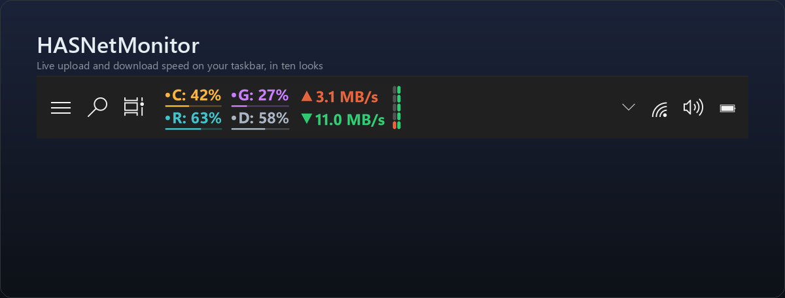
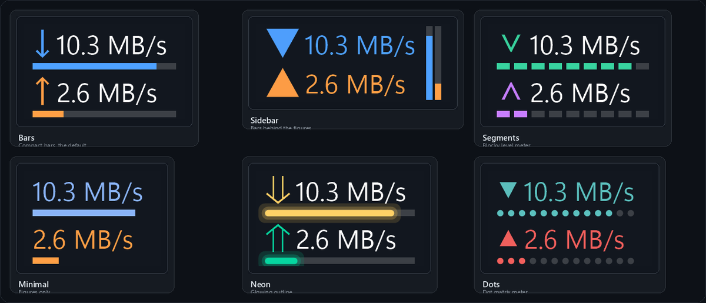
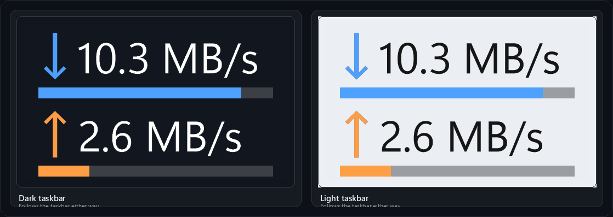
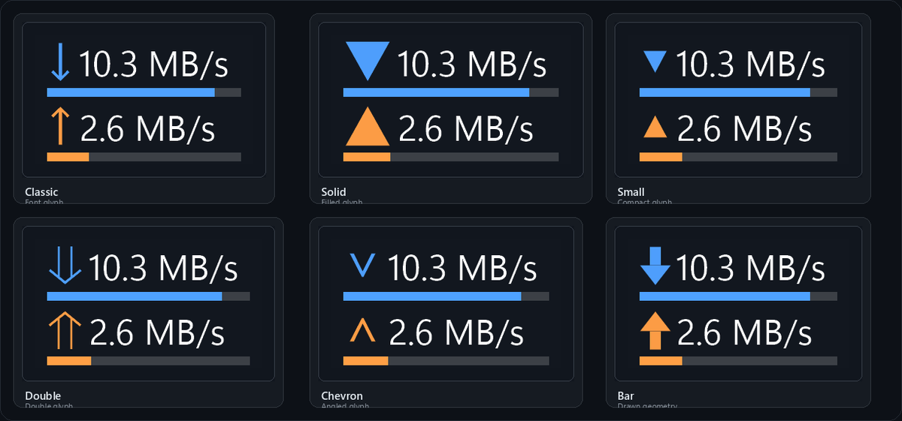
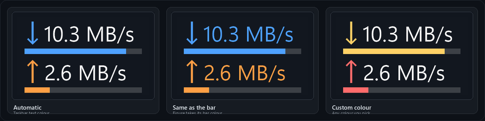
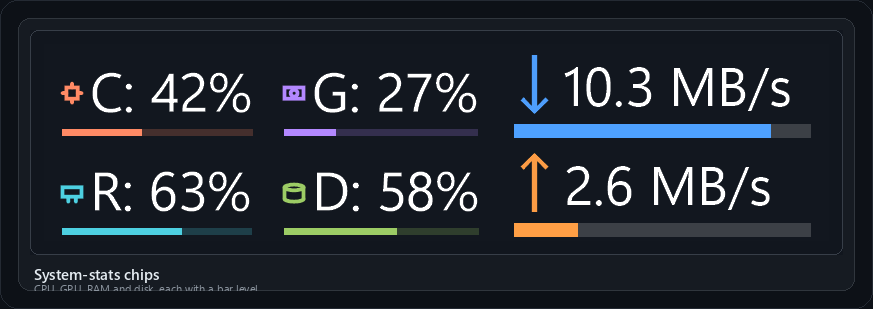

# HAS NetMonitor

A small always-on-top Windows widget that sits on the taskbar next to the tray and
shows live download and upload speed as coloured bars, text, or both.



It is taskbar-owned, seats itself above the shell, and repairs its own presence if the
shell hides or buries it.

- Ten looks, two stacking orders, selectable font family/size/weight
- Seven arrow styles, including a drawn bar arrow and no arrow at all
- Bar and figure colours you pick, or figures that follow their bar
- A glassy look: translucent tracks and chip pills, on any style
- System-stats chips with their own colour each, a level ring or bar, and vector icons
- Position it by distance from the tray, then nudge it left/right/up/down in pixels
- Settings apply to the live widget as you change them
- Optional start with Windows (per-user `Run` key, no admin rights needed)
- Config is a plain JSON file you can edit by hand, saved automatically
- **About** box with the version, author, contact address and licence

## Presets

Twenty-five ready-made looks, applied in one click from **Settings → Presets**. A preset sets
the colours, style, bar thickness, arrow style, font size, bold/italic and the plate in one
go; it leaves the refresh rate, the scale and the position alone, since those are not part of
a look. The first entry, **HAS Preset**, is the look a new install starts with.

Choosing **Custom** returns the dialog to hand editing. Editing any control after applying a
preset also drops the picker back to Custom, because the name would no longer be true.

Below the built-in gallery, **Saved looks** keeps your own. Set the widget up the way you
like, press **Save current**, give it a name, and it is written to `presets.json` beside
`config.json` and offered in that list from then on - including after an upgrade or a
restart. **Delete** removes the selected one; the last remaining saved look is kept so the
list never goes empty on you. A saved look stores the same fields a built-in preset does, so
picking it reproduces exactly what you saved and never touches the refresh rate, the scale or
the position.

Every preset is checked to stay visible on both a dark and a light taskbar: a bar colour that
would sink into the background is rejected, so no preset can render an empty-looking widget.

## Designs

Ten looks, each keeping the same live figures. Pick one under **Settings → Look → Style**.



Every look adapts to the taskbar it sits on, dark or light:



### Arrow styles

The arrow in front of each figure is selectable, so the widget can match the rest of your
tray or disappear into it. Chosen with **Settings → Look → Arrow type**:



### Figure colours

The figures can follow the taskbar, take their bar's colour, or use a colour you choose.
Chosen with **Settings → Colours and behaviour → Download/Upload text**:



### System-stats chips

The optional CPU, RAM, GPU, disk and battery chips sit beside the traffic figures. Each one
has its own colour (**Settings → Colours and behaviour → Chip colours**), so the chips need not
share the traffic palette. Each chip's **text** colour is set separately (**Chip text colours**),
so a chip can have, say, an orange dot with white text. Tick **Text matches chip colour** to use
one colour for both the chip and its text.



Every colour group has a **Reset** button beside it — bar colours, figure colours, chip colours
and chip text colours — which clears the group back to its defaults. A chip colour left unset
follows the built-in palette, and a chip text colour left unset follows the figure colour, so
resetting never leaves a chip invisible.

Each chip can also show its level, chosen with **Settings → Colours and behaviour → Chip level**:

- **Dot** — the plain marker, as before.
- **Ring** — the marker becomes a ring filled to the metric's percentage.
- **Bar** — a thin bar under the chip, filled to the percentage.

The marker itself is chosen with **Settings → Colours and behaviour → Chip marker**: the original
`C:`/`R:`/`G:` letters, or drawn vector icons (a CPU square, a RAM stick, a GPU card, a disk
cylinder and a battery). **Chip shape** adds a translucent glass pill behind each chip, and
**Glass tracks** draws the bar tracks and fills with the same frosted look. Both work with any
style, so the glassy look is a toggle rather than a style of its own.

---

## Download

Get the Setup exe from the [latest release](https://github.com/hanifalisohag/HASNetMonitor/releases/latest):

`HASNetMonitor-Setup-<version>.exe` — one file, per-user, no admin rights, no runtime to
download. Every push to `main` builds it and publishes it, so the newest release is always
the current code. All releases are listed on the [releases page](https://github.com/hanifalisohag/HASNetMonitor/releases).

## Requirements

|                   |                                                                |
| ----------------- | -------------------------------------------------------------- |
| OS                | Windows 11 (developed and tested here); Windows 10 is untested |
| .NET SDK          | 11.0.100 or later (`dotnet --version`)                         |
| Python (optional) | Only to regenerate the icon; needs Pillow                      |

The app targets `net11.0-windows` and uses WinForms. It runs from a single folder and
needs no installer.

## Build

```bash
dotnet restore
dotnet build
```

Debug output lands in `bin/Debug/net11.0-windows/HASNetMonitor.exe`.

Always target `HASNetMonitor.csproj` explicitly when you use `-o`/`--output` or
publish. The folder also contains `HASNetMonitor.slnx`, which includes the test
project, and an output path applied to the solution copies test assemblies into the
app folder (`NETSDK1194`).

## Run

```bash
# from source (rebuilds if needed)
dotnet run --project HASNetMonitor.csproj

# the built exe
./bin/Debug/net11.0-windows/HASNetMonitor.exe
```

Only one instance runs: a second copy takes the `Local\HASNetMonitor.Instance`
mutex and exits quietly, so two widgets never fight over the same spot.

Run it for a fixed time when you just want to look at it (seconds, capped at 600):

```bash
./bin/Debug/net11.0-windows/HASNetMonitor.exe --smoke 10
```

Right-click the widget for the menu. It has no taskbar button, so quit it from the menu
(**Exit**) rather than closing a window.

## Test

```bash
dotnet test                                  # everything
```

Run the test project directly for filtered or Release runs:

```bash
# one class
dotnet test tests/HASNetMonitor.Tests/HASNetMonitor.Tests.csproj \
  --filter "FullyQualifiedName~TaskbarGeometryTests"

# one test
dotnet test tests/HASNetMonitor.Tests/HASNetMonitor.Tests.csproj \
  --filter "FullyQualifiedName~NudgeMovesTheWidgetByExactlyTheGivenPixels"

# only the target you ship
dotnet test tests/HASNetMonitor.Tests/HASNetMonitor.Tests.csproj -f net48

# Release, without rebuilding
dotnet test tests/HASNetMonitor.Tests/HASNetMonitor.Tests.csproj \
  -c Release --no-build

# coverage (coverlet, writes coverage.cobertura.xml)
dotnet test tests/HASNetMonitor.Tests/HASNetMonitor.Tests.csproj \
  --collect:"XPlat Code Coverage" --results-directory TestResults
```

The suite is 320 tests per target, and it runs against **both** app targets, so the
`net48` build that ships is held to exactly the same tests as the development build.
Use `-f net48` to test only the shipping target — slower per test, but it exercises the
.NET Framework code paths (config parsing, compatibility helpers). Five of them drive real
windows (visibility, hit-testing, topmost repair). They are `SkippableFact`s and are
reported as **skipped** when the session is locked or otherwise cannot show a window —
that is expected, not a failure. Unlock and run again to exercise them.

## Clean

```bash
dotnet clean
dotnet clean -c Release
```

Removes `bin/` and `obj/` artefacts for that configuration.

## Release

Publish the project, not the folder:

```bash
# The one to distribute: 239 KB exe, nothing to install on the target.
dotnet publish HASNetMonitor.csproj -c Release -f net48 -o publish

# Needs the .NET 11 Desktop Runtime on the target machine (~5 files).
dotnet publish HASNetMonitor.csproj -c Release -f net11.0-windows \
  -r win-x64 --self-contained false -o publish

# One self-contained exe, nothing to install, but ~53 MB compressed / 115 MB plain.
dotnet publish HASNetMonitor.csproj -c Release -f net11.0-windows \
  -r win-x64 --self-contained true -p:PublishSingleFile=true -o publish
```

See [Shipping a small exe](#shipping-a-small-exe) for what to hand out and why.

Trimming (`-p:PublishTrimmed=true`) and NativeAOT are refused by the SDK for WinForms
(`NETSDK1175`), so neither can shrink the modern build. That is the reason the small
build targets .NET Framework instead.

## Shipping a small exe

```bash
dotnet publish HASNetMonitor.csproj -c Release -f net48 -o publish
```

Output:

| File                | Size   | Needed?            |
| ------------------- | ------ | ------------------ |
| `HASNetMonitor.exe` | 249 KB | yes, the whole app |
| `HASNetMonitor.pdb` | 39 KB  | no, debug symbols  |

The exe is the only file to copy. There is no `HASNetMonitor.exe.config`: .NET Framework
would normally take its DPI mode from one, so `Core/DpiAwareness.cs` claims
`PerMonitorV2` through `user32` before the first window exists, which is the same setting
without a second file to ship.

**Why .NET Framework.** No modern .NET is part of Windows: the .NET 11 Desktop Runtime is
a separate installer, and a self-contained build carries ~50 MB of runtime. .NET Framework is
an OS component, so a Framework exe contains only this app's code — hence 239 KB rather
than 53 MB. The in-box versions are: Windows 8 → 4.5, 8.1 → 4.5.1, 10 1809 → 4.7.2,
10 1903+ and 11 → 4.8. This build targets 4.8, so **Windows 10 1903+ and Windows 11** are
supported; Windows 8/8.1 would need a 4.5 fallback that is not built.

What the `net48` build does differently, so it stays small and dependency-free:

- **Config JSON** uses the in-box `JavaScriptSerializer` instead of `System.Text.Json`,
  which would drag several DLLs next to the exe. A small pre-pass strips `//` and `/* */`
  comments and trailing commas first, so a config file stays interchangeable between the
  two builds. `Core/ConfigJson.cs`.
- **Compatibility helpers** in `Core/Compat.cs`, `Core/Numeric.cs` and `Core/Elapsed.cs`
  stand in for `Math.Clamp`, `double.IsFinite`, `Stopwatch.GetElapsedTime`,
  `Environment.ProcessPath` and `NativeLibrary`, which the Framework lacks.
- **DPI awareness** is set in code by `Core/DpiAwareness.cs` calling
  `SetProcessDpiAwarenessContext` with `PER_MONITOR_AWARE_V2`, falling back to
  `SetProcessDPIAware` on older Windows. It runs first in `Main`, before any window, and
  replaces the `App.config` the Framework would otherwise need — so no
  `HASNetMonitor.exe.config` ships beside the exe.

Both targets compile from the same sources with `#if NETFRAMEWORK` only inside those
compatibility files, and the whole test suite runs on both.

## Build the installer locally

`installer\HASNetMonitor.iss` is an Inno Setup 6 script that packs the `net48` publish
output, so publish first and then compile it (both lines run in PowerShell):

```powershell
# 1. the build the installer ships
dotnet publish HASNetMonitor.csproj -c Release -f net48 -o publish

# 2. compile the script

& "$env:LOCALAPPDATA\Programs\Inno Setup 6\ISCC.exe" installer\HASNetMonitor.iss
```

That writes `installer\Output\HASNetMonitor-Setup-1.6.0.exe` — the same per-user,
no-admin, no-runtime-download installer the releases carry.

The compile line above is PowerShell syntax: `$env:LOCALAPPDATA` does not exist in
`cmd.exe`, which spells the same folder `%LOCALAPPDATA%`, and a command that begins with
a quoted path needs the `&` call operator in PowerShell or it parses as a string followed
by stray arguments. Run the whole block in one shell and neither problem arises.

Needs Inno Setup 6 (`winget install JRSoftware.InnoSetup`); it installs `ISCC.exe` under
`%LOCALAPPDATA%\Programs\Inno Setup 6`, which is not on `PATH`.

What the script takes, and what to override:

| Input         | Default                                           | Override             |
| ------------- | ------------------------------------------------- | -------------------- |
| published exe | `..\publish` beside the script                    | `/DPublishDir=<dir>` |
| version       | the `#define` fallback, kept equal to `<Version>` | `/DAppVersion=1.2.0` |
| output        | `installer\Output`                                | `/DOutputDir=<dir>`  |

The publish folder is the only input the script has: a stale `publish\` produces a Setup
exe carrying the old `HASNetMonitor.exe`, which installs and runs without complaint, so
re-publish after any code change. `installer\config.default.json` and the repository
`LICENSE` are packed from beside the script, not from the publish folder. A manual
compile uses the version baked into the script; only the workflow passes the one it
reads from the project file, so pass `/DAppVersion=` too if you bumped `<Version>`.

`.github/workflows/installer.yml` runs these same two steps on every push to `main` and
publishes the result as the release asset.

## Diagnostics

```bash
# prints a report, then exits 0 on PASS and 1 on FAIL
./bin/Debug/net11.0-windows/HASNetMonitor.exe --self-test

# or run it straight from source
dotnet run --project HASNetMonitor.csproj -- --self-test
```

`--self-test` also writes a rendered frame to
`%TEMP%\taskbar-monitor-preview.png`, which is the quickest way to inspect a look
without touching your taskbar.

If the widget misbehaves (hides, blinks, jumps), log what it sees:

```bash
TNM_TRACE=trace.log ./bin/Debug/net11.0-windows/HASNetMonitor.exe --smoke 10
```

`TNM_TRACE` takes a file path and records every show/hide/reorder decision with a
millisecond timestamp, plus a sampler that notes when the widget's pixels go blank.
The file is appended to, so delete it between runs. Leave the variable unset to turn
tracing off.

## Configuration

Settings are stored per user at:

```
%APPDATA%\HASNetMonitor\config.json
```

There is nothing to open and nothing to save by hand: the file is written whenever a
setting changes, by the tray switches as well as by the settings dialog. Setup seeds it
for a new user from `installer\config.default.json`, and if it is absent when the app
starts the app writes it itself — both place the same starting settings, which are the
author's own working configuration rather than a bare default, so a fresh install looks
right immediately and the user only changes what they want. An existing `config.json` is
never overwritten by setup, a reinstall or an upgrade. A `config.json` next to the exe is
read as a fallback and then saved to the per-user path. The file is plain JSON, tolerates comments and trailing commas, and is
repaired on load — out-of-range values are clamped, unknown style names fall back to
`Bars`.

The `Default` column below is what a new install starts with, i.e. the values in
`CreateInitial()` in `Core/MonitorConfig.cs`. `new MonitorConfig()` on its own keeps the
plainer baseline the renderer uses.

| Key                     | Default           | Range / values                                                  |
| ----------------------- | ----------------- | --------------------------------------------------------------- |
| `DownloadColorHex`      | `#2ECC71`         | any `#RRGGBB`                                                   |
| `UploadColorHex`        | `#E6643C`         | any `#RRGGBB`                                                   |
| `RefreshIntervalMs`     | `1000`            | 250–60000                                                       |
| `OffsetFromTrayPx`      | `6`               | 0–64                                                            |
| `NudgeXPx`              | `0`               | −400–400                                                        |
| `NudgeYPx`              | `0`               | −400–400                                                        |
| `AutoScale`             | `true`            | `true`/`false`                                                  |
| `SharedScale`           | `true`            | `true`/`false`                                                  |
| `MaxScaleMbps`          | `100`             | 0.01–100000                                                     |
| `ShowText`              | `true`            | `true`/`false`                                                  |
| `ShowBackdrop`          | `false`           | `true`/`false`                                                  |
| `BackdropOpacity`       | `255`             | 0–255                                                           |
| `CrispText`             | `false`           | `true`/`false`                                                  |
| `ArrowSizePercent`      | `150`             | 50–300, arrow ink height against a digit's                      |
| `ArrowStyle`            | `Small`           | `Classic`, `Solid`, `Small`, `Double`, `Chevron`, `Bar`, `None` |
| `DownloadTextColorMode` | `Bar`             | `Auto`, `Bar`, `Custom`                                         |
| `DownloadTextColorHex`  | `#2ECC71`         | `#RRGGBB`, used when the mode is `Custom`                       |
| `UploadTextColorMode`   | `Bar`             | as above, for the upload row                                    |
| `UploadTextColorHex`    | `#E6643C`         | as above                                                        |
| `BarThicknessPx`        | `3`               | 1–24                                                            |
| `SegmentGapPx`          | `1`               | 0–12                                                            |
| `FontSizePt`            | `10.5`            | 6–20                                                            |
| `Style`                 | `SidebarSegments` | see below                                                       |
| `SortOrder`             | `UploadFirst`     | `DownloadFirst`, `UploadFirst`                                  |
| `FontFamily`            | empty             | an installed family name, or empty to match the taskbar         |
| `FontBold`              | `true`            | `true`/`false`                                                  |
| `FontItalic`            | `false`           | `true`/`false`                                                  |
| `RoundedBars`           | `true`            | `true`/`false`                                                  |
| `AccentGlow`            | `false`           | `true`/`false`                                                  |
| `StartWithWindows`      | `true`            | `true`/`false`                                                  |
| `ShowCpu`               | `true`            | `true`/`false`                                                  |
| `ShowRam`               | `true`            | `true`/`false`                                                  |
| `ShowGpu`               | `false`           | `true`/`false`                                                  |
| `ShowDisk`              | `false`           | `true`/`false`                                                  |
| `ShowBattery`           | `false`           | `true`/`false`                                                  |

Styles: `Bars` (classic rows), `Level` (segmented level meter), `Sidebar` (vertical
bars), `SidebarSegments` (vertical bars split by gaps), `Neon` (glow, rounded caps),
`Segments` (chunky blocks), `Dots` (dot matrix), `Minimal` (hairline fills, no track),
`Gradient` (fills that fade out towards the empty end) and `Outline` (a hollow track
outline with a thinner fill inside it).

A nudge is applied after the normal seat next to the tray and is clamped to the
taskbar's own bounds — it can reach the bar edge but never leave the bar. On a 48 px
taskbar there are only a few pixels of vertical room, so a large `NudgeYPx` there
does little by design.

Start with Windows writes `HKCU\Software\Microsoft\Windows\CurrentVersion\Run`,
value `HASNetMonitor`, pointing at the executable that is running. The config is the
source of truth: the key is re-applied on every start, which also repairs it after a
Windows update removes it.

To start over, exit the app and delete the config folder; the next start writes the
initial preset again.

## Look

When text is on, each row is the direction arrow followed by the figure:

- the arrival (download) arrow is drawn in the download colour, the departure (upload)
  arrow in the upload colour, so a row is identified before the number is read;
- the figure itself is drawn in the **Look → Download text** / **Upload text** colour:
  _Automatic (taskbar)_, _Same as the bar_, or _Custom colour_ picked with the swatch
  beside the list. So the figures can be white on a dark taskbar, green and red to match
  the bars, or any pair of colours you like, and the arrow keeps the bar colour either way;
- **Arrow size** is a spinner: 0.5 to 3.0 in steps of 0.1, so 0.5, 0.6, 1.0 and 2.0
  are all one click apart, and the value is a multiple of a digit's _ink height_ — 1.0 is
  the figure's own size, 1.5 (the default) makes the arrow's ink half again as tall. Its
  right-click menu jumps straight to the round stops (0.5, 1, 1.5, 2, 3) and keeps any
  other value you have set as its own entry. The spinner is `ArrowSizePercent` in the
  config file, so 1.5 there is `150`;
- **Arrow type** picks the marker: _Classic_ ↑↓, _Solid_ ▲▼, _Small_ ▴▾, _Double_ ⇑⇓,
  _Chevron_ ⌃⌄, _Bar_ (a stem and head drawn as a shape, not a glyph) or _None_. A family
  that lacks the chosen code point falls back to the classic arrows, because a missing
  glyph draws as an empty box;
- U+2191/U+2193 are drawn shorter than the digits in every UI font — 8.1 px against 8.7 at
  a 12 px em — which is why an arrow at the figure's own size read as a small tick; the
  renderer measures a family's digit-to-arrow ratio once and folds it into the setting;
- the arrow is **capped by its row**: it may grow until its ink fills the row the figure
  sits in, and not one pixel further, so a tall arrow never runs into the bar beneath it or
  costs the figure a font size. At the default 48 px taskbar a 12 px figure carries an
  18 px arrow;
- the arrow is drawn at 254/255 opacity, one step under the figure, so the number always
  remains the most solid ink in its row — the arrow is the direction marker, not the reading;
- glyphs are built from a whole-pixel em size, so their stems land on pixel columns and
  stay even at every taskbar height and display scale;
- glyphs are rasterised with grid-fitted antialiasing, the same treatment the taskbar
  clock gets. Subpixel (ClearType) rendering is not possible on the default transparent
  bitmap: it needs an opaque background to compute its colour fringes, and the widget's
  bitmap is transparent by design so the real taskbar shows through.

The arrow is not part of the speed string: `SpeedFormatter.Format` returns the figure
only, and the renderer draws the two runs side by side from the configured colours, each
with its own font — the arrow at the configured size, centred on its own ink so the
arrowhead lands on the figure's line.

### How the two bars are scaled

Both rows are measured against **one** full-scale rate — the faster of the two
directions — so the bars can be compared directly: 10 MB/s down beside 14 KB/s up draws a
long download row and an upload row a pixel wide, exactly as the numbers say. This is the
default (`SharedScale: true`, **Bar scale: One scale for both bars** in the Look group).

That full scale is a **round step**, not whatever the rate happened to be. The steps
double from 16 KB/s — 16, 32, 64, 128, 256, 512 KB/s, 1 MB/s, 2, 4, 8, 16 MB/s — with the
round decimal marks 2.5, 5, 10, 20, 40 and 80 MB/s interleaved above 2 MB/s. The faster
direction picks the next step at or above it, and both bars fill against that step, so a
bar length always means a rate that can be named:

| fastest rate        | full scale         | download bar (of 60 px) | upload bar |
| ------------------- | ------------------ | ----------------------- | ---------- |
| 15 KB/s / 10 KB/s   | 16 KB/s            | 56 px                   | 38 px      |
| 345 KB/s / 564 KB/s | 1 MB/s (1024 KB/s) | 20 px                   | 33 px      |
| 10 MB/s / 14 KB/s   | 10 MB/s            | 60 px                   | 1 px       |

The decimal marks are what keep a flat-out link from reading half empty: without them
9 MB/s would fill against 16 MB/s and sit at 56%. With them it fills against 10 MB/s, and
no rate ever draws below about 62% of its scale.

The scale rises at once, so a burst is never clipped, and falls only after the rate has
stayed below it for 3 seconds (`AutoScaler.StepDownHoldSeconds`). Because a rate just
under the current step still selects that same step, a rate sitting on a boundary cannot
flicker the row between two lengths.

Turned off, each direction fills against **its own** peak. That keeps a trickle of
upload visible beside a flood of download, at the cost of both rows reading "full" no
matter how they compare — 14 KB/s of upload drew 53 of 60 px next to 10 MB/s of
download.

With `AutoScale` off, `MaxScaleMbps` is one peak for both rows either way, used exactly as
entered rather than snapped to a step, so the option only changes what auto-scaling does.

### Sharpness: matching the clock exactly

**Crisp text like the clock** (Look group, off by default) renders the glyphs with
ClearType on a fully opaque plate, which is what makes them identical to the clock's.
The plate is the price: it hides the taskbar behind the widget. The option forces the
tint opaque, and the tint-opacity spinner is disabled while it is on, so the dialog
never shows a value the renderer overrides. Setting the tint opacity to 255 by hand is
the same thing, and also switches the glyphs to ClearType.

## Widget statistics

Beside the traffic rows, the widget can show compact chips describing the machine it
sits on: a drive-letter-style tag for each stat — **C:** CPU, **R:** RAM, **G:** GPU,
**B:** battery and **D:** disk (how busy the drives are, from the Windows "PhysicalDisk"
counters — the `_Total` instance sums every drive into one figure, the same number Task
Manager calls "Active time"), each followed
by its percentage. The chips are drawn at the same size as the figures in the same family and
style, so the statistics read as part of the widget rather than a second, smaller widget bolted
onto it. Each has its own toggle (**Settings**, the chips row in the second column), and they
appear in the tray tooltip's one-line caption as well. All five are off by default
except CPU and RAM, which are on for a fresh install: a machine always has a CPU and some
RAM, so a new install is immediately informative.

The chips live in a columnar grid on the **left** of the widget, beside the download and
upload figures: at most two chips per column, filled top-down, one column every two
items — the leftmost column carries CPU and RAM, the next GPU, then battery and any other
stat. Each chip appears as its toggle is enabled; the column grows to fit the widest chip
in it. Chips are centred on the figure rows they sit beside, so they never push the traffic
out of the bar.

An enabled chip always keeps its slot. A reading that is not available — GPU counters
that do not resolve, a drive that cannot be read — shows a `--` placeholder rather than
dropping out, so the widget never shows a confident-looking zero and its size never
changes when a reading comes and goes. A single failed read does not blank a chip the
user is already looking at: the last known value is held briefly, and once the failure
lasts past a few seconds the chip falls back to the placeholder. Each metric is sampled on
its own background thread, so a slow read — a GPU sweep, a disk query on a spun-down drive —
delays only that chip: the others keep advancing on time, and the slow one keeps its last
value until its own read finishes. The battery chip is
the one exception: it disappears whenever the machine is on AC power, because a laptop
on the charger has nothing to gain by quoting its own charge. On a taskbar that is too
short for the figures, the figure is shrunk first; the chips ride along beside it and
are never dropped to make room.

`ShowGpu` is off by default because GPU telemetry is not universal: the performance-counter
signals are absent on some drivers. The widget first tries the generic PDH counters, then
falls back to the NVIDIA Management Library directly (`nvml.dll`) when they fail to resolve,
and if neither path works the chip stays invisible rather than lying. `ShowDisk` and
`ShowBattery` are opt-in for the same reason — the chip should not appear on a machine
that cannot fill it. The disk chip reads the `_Total` "PhysicalDisk" counter, so one chip
stands for every drive; when that instance is missing it falls back to the first physical
disk, and if no counter resolves the chip shows a placeholder rather than a zero.

## Settings dialog

Changes apply to the live widget immediately, including start with Windows: the dialog
has no preview of its own, so what you see on the taskbar is the real thing.

- **OK** saves to `config.json`.
- **Cancel** (or closing the window) restores what was there before you opened it,
  including the `Run` entry.

Groups: **Look** (style, stacking, font, weight, bar shape, thickness, segment gap,
font size, text), **Position** (offset from tray, nudges with arrow buttons, reset),
**Colours and behaviour** (colours, refresh, scaling, backdrop, start with Windows).

A bare row of chips sits under the Colours column: **CPU**, **RAM**, **GPU**, **Disk**
and **Battery (when on battery)**. The chips are the widget's optional statistics column;
each one toggles its chip, and a chip that cannot be filled stays hidden rather than showing a
confident-looking zero.

## Tray menu

| Item               | What it does                                       |
| ------------------ | -------------------------------------------------- |
| Settings…          | Opens the dialog                                   |
| Look               | Style, stacking order, bold, italic                |
| Position           | Nudge left/right 4 px, up/down 2 px, reset         |
| Reset bar scaling  | Resets the auto-scaler and the smoothed bar values |
| Start with Windows | Toggles the `Run` entry                            |
| About…             | App name, version, author, contact and licence     |
| Exit               | Quits                                              |

## Version and identity

`HASNetMonitor.csproj` holds `<Version>`, `<Product>`, `<AssemblyTitle>` and
`<Authors>`, which the SDK turns into the exe's file properties. `Core/AppInfo.cs` reads
the version back from the assembly (dropping any `+commit` build suffix) and holds the
display name, author and contact address, so the About box, the tray tooltip and the
file on disk cannot disagree. To ship a new version, change `<Version>` and rebuild.

The product is **HAS NetMonitor**; the file is `HASNetMonitor.exe`, the project and
solution are `HASNetMonitor.csproj` / `HASNetMonitor.slnx`, the C# root namespace is
`HASNetMonitor`, and the config lives in `%APPDATA%\HASNetMonitor`.

## License

HAS NetMonitor is released under the MIT License **with an attribution requirement**:
every copy, modification or redistribution must credit the author, **Md Hanif Ali
Sohag**, by name. The full terms are in `LICENSE` at the repository root, which is the
one source of the wording:

- `LICENSE` is embedded in the exe as the resource `HASNetMonitor.LICENSE`
  (`Core/LicenseInfo.cs` reads it), so the About box shows the same text an installed
  copy ships with, whichever folder the exe runs from.
- The About box shows `License: MIT License - Must credit Md Hanif Ali Sohag as the
original author` with a **View full license** link.
- Setup shows the same `LICENSE` on its licence page, and names the author as the
  publisher in Apps & features.
- The exe's file properties carry `<Copyright>Copyright (c) 2026 Md Hanif Ali Sohag`
  and `MIT` as the licence expression.

Changing the licence means editing `LICENSE` alone: the embedded resource, the About
box, the installer page and these tests all read from it.

Upgrading from a build under the previous name:

| What            | Effect                                                                                                                                                                      |
| --------------- | --------------------------------------------------------------------------------------------------------------------------------------------------------------------------- |
| Config folder   | The build reads `%APPDATA%\HASNetMonitor`. Settings saved by the old build are not read, so a fresh install starts from defaults.                                           |
| Logon entry     | `HKCU\...\Run` gets `HASNetMonitor`. An entry left by the old build is not touched; if you enabled **Start with Windows** before, delete that old `Run` value once by hand. |
| Single instance | The mutex is `Local\HASNetMonitor.Instance`, so one old and one new build can run side by side once.                                                                        |

## Project layout

```
Program.cs                 entry point, --self-test / --smoke, single-instance guard
SelfTest.cs                environment and rendering checks behind --self-test
Core/DpiAwareness.cs       PerMonitorV2 in code, so no exe.config has to ship
Core/                      config, styles, fonts, geometry, traffic sampling
  ConfigJson.cs            config JSON, one backend per target
  Compat.cs                net48 stand-ins for .NET 11 only APIs
  Numeric.cs, Elapsed.cs   Math.Clamp / IsFinite / Stopwatch helpers, both targets
  IsExternalInit.cs        net48 polyfill for `init` accessors
  AppInfo.cs               name, version, author, contact: the About box's only source
  LicenseInfo.cs           reads the embedded LICENSE for the About box
Interop/                   Win32 declarations
Rendering/                 layout and the widget renderer
UI/                        layered window, taskbar widget, settings and About dialogs, host
Assets/HASNetMonitor.ico   app icon
tools/make_icon.py         regenerates the icon from the design grid
tests/HASNetMonitor.Tests  xUnit tests, run on both targets
  MathBridge.cs            net48 alias so the tests' Math.Clamp compiles
```

## Regenerating the icon

`Assets/HASNetMonitor.ico` is the single definition of the app mark: it drives the
exe icon in Explorer, the notification-area (tray) icon, and the settings dialog. The
file is also embedded as an assembly resource, so the tray and dialog load it without
depending on where the exe lives — no surface draws its own copy, which is what keeps
them identical.

To change the mark, edit the 16-unit grid in `tools/make_icon.py` and run:

```bash
python -m pip install pillow   # once
python tools/make_icon.py
dotnet build -t:Rebuild
```

Keep every size in `SIZES` in `tools/make_icon.py`: the shell asks for 16, 20, 24, 32
and 40 px depending on DPI and view, and a missing frame gets scaled, which looks soft.

## Troubleshooting

**The widget is not visible.** Open Start once; the widget re-seats itself above the
shell. If it is still missing, check that it is not off the taskbar: **Position → Reset
position**.

**A second copy exits immediately.** By design — one instance only.

**Tests skip instead of running.** The session is locked or has no interactive
desktop, so window visibility and hit-testing cannot be observed. Unlock and rerun.

**Tests fail on window behaviour after a big change.** Re-run with `--self-test` and
compare the `[info] taskbar=… tray=… dpi=…` line against your taskbar; it reports the
geometry the app actually resolved.
